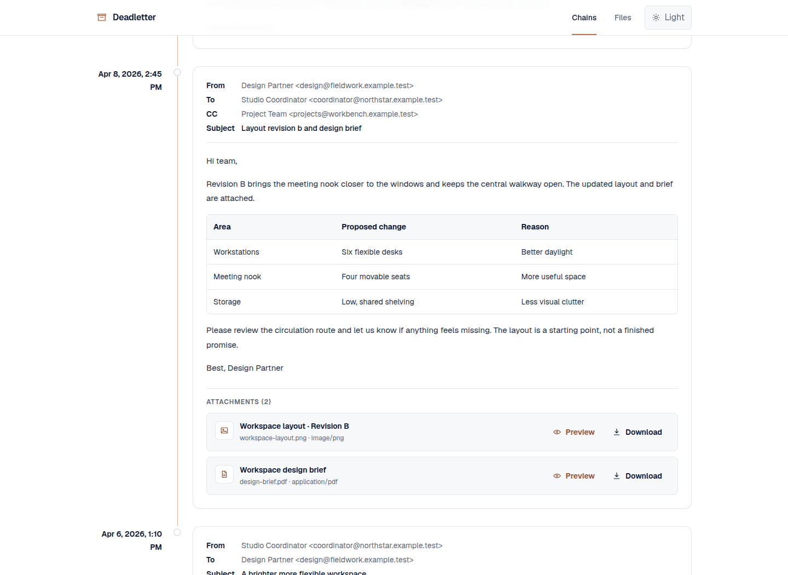

# Agent-assisted imports

Deadletter's intended ingestion workflow uses a local coding agent to turn
user-provided email exports and original attachments into the canonical
filesystem archive. The web application itself is read-only with respect to
archive content: it does not upload, extract, OCR, split, or edit messages.

The operational procedure is bundled as the
[`import-email-export` skill](../.github/skills/import-email-export/SKILL.md).
The [Archive Content Format Specification](archive-content-format.md) is the
canonical human-readable contract; the Zod schemas, parsers, and tests are the
executable authority when behavior is unclear.

## Supported source material

The skill is designed for imperfect, overlapping source sets, including:

- searchable or scanned PDF email exports;
- plain-text, Markdown, or copied email threads;
- PDFs containing multiple messages or repeated quoted history;
- exports with page headers, footers, visual line wrapping, or OCR artifacts;
- separately supplied original attachments; and
- multiple exports that partially duplicate one another.

This workflow is intentionally supervised. An agent can perform deterministic
extraction and normalization, but it must surface unresolved dates, message
boundaries, identities, duplicates, and attachment ownership for a human
decision rather than inventing data.

## Install the bundled skill

The canonical skill lives in `.github/skills/import-email-export/`. Create one
repository-local discovery link for the coding agent you use. Run the command
from the Deadletter repository root.

### Codex

Codex discovers project skills under `.agents/skills/`:

```bash
mkdir -p .agents/skills
ln -s ../../.github/skills/import-email-export .agents/skills/import-email-export
```

Start a new Codex session if an existing session does not discover the newly
linked skill. Invoke it as `$import-email-export`, or explicitly ask Codex to
use the `import-email-export` skill.

### Claude Code

Claude Code discovers project skills under `.claude/skills/`:

```bash
mkdir -p .claude/skills
ln -s ../../.github/skills/import-email-export .claude/skills/import-email-export
```

Start a new Claude Code session if necessary. Invoke `/import-email-export`, or
ask Claude Code to use the skill by name.

The discovery links are ignored by Git and point to the single maintained
skill. If a link already exists, inspect it rather than replacing it blindly.

## Prepare an import request

Place source material in a private location readable by the local agent and
outside the final archive tree. Keep originals unchanged. Provide the agent
with the following information:

1. **Source paths.** Identify every export and attachment directory to inspect.
2. **Target.** State whether this is a new chain or an extension of an existing
   one, and provide the desired title. Supply a slug when you care about it; the
   agent can propose a valid slug otherwise.
3. **Archive root.** Give the intended root explicitly, especially when it is
   not the `ARCHIVE_DATA_DIR` already configured for the environment.
4. **Organization.** Name the collection and category, if the chain should be
   organized beneath existing virtual groupings.
5. **Timezone.** Supply the source timezone when timestamps omit an offset.
   Include the geographic zone when daylight-saving rules matter, for example
   `America/New_York`, rather than asking the agent to use the server timezone.
6. **Attachment availability.** Include original files and identify known
   missing files. A filename mentioned in an email is not a substitute for the
   attachment bytes.
7. **Mutation authority.** Say whether existing entries may only be extended or
   may also be corrected/replaced. The skill never silently overwrites valid
   archive content.
8. **Scope.** Say whether all source messages belong to one chain. Real-world
   subject threads should normally remain distinct chains when merging them by
   date would make the archive confusing.

Do not include credentials in the prompt or archive. Private content should be
processed locally; explicitly authorize any disclosure before an agent uses an
external document-processing service.

## Example requests

New chain:

```text
Use the import-email-export skill. Import the PDFs and original attachments in
/private/import/roofing into a new chain titled "Example Roofing Emails" under
the "Insurance Records" collection. The source timezone is America/New_York.
Use /srv/deadletter/archive/chains as the archive root. Preserve the source
files and stop for unresolved required metadata or attachment ownership.
```

Existing chain:

```text
Use the import-email-export skill to inspect /private/import/follow-up.pdf and
/private/import/attachments. Add only new messages to the existing
example-roofing-emails chain. America/New_York is the source timezone. Do not
replace existing entries without showing me the material difference first.
```

Paths and titles above are examples. Use locations appropriate to your own
private deployment.

## Expected interaction

The agent should:

1. inspect the target archive and preserve existing IDs, resource IDs, and
   valid files;
2. preserve source exports as read-only and use a separate temporary workspace;
3. extract text directly where reliable and use OCR only where needed;
4. inventory messages across all sources before writing files;
5. identify message boundaries from headers and context, not PDF pages alone;
6. normalize required metadata, using the approved timezone and never
   fabricating missing fields;
7. deduplicate overlapping exports and quoted history without discarding unique
   inline replies or evidentiary context;
8. inventory and match original attachments, reporting unavailable files
   rather than creating placeholders;
9. present a concise plan before a nontrivial or ambiguous import;
10. write or stage canonical `chain.yml`, Markdown, and attachment files; and
11. run focused parser/path checks and the repository's established validation.

For a small, unambiguous import, the agent may proceed after inspecting its plan
internally. It should stop before writing when required metadata remains
unknown, message boundaries materially affect chronology, attachment ownership
is ambiguous, or an existing file would be destructively replaced.

## Review and completion

The agent's completion report should identify sources processed, the target
chain, created/skipped/updated messages, copied or missing attachments, the
timezone applied, unresolved ambiguity, files changed, and validation results.
It should not repeat full private bodies or unnecessary personal information.

The user performs the final content review. Check that:

- the chain appears in the intended collection/category;
- message chronology, senders, recipients, subjects, and body boundaries are
  faithful to the exports;
- deduplication did not remove unique replies or annotations;
- attachment ownership and filenames are correct;
- preview/download behavior is appropriate for each file type; and
- no extraction artifacts, temporary files, sources, or private records were
  placed in Git or `public/`.

A completed import keeps recipients, CC, subject, formatted body, and original
attachments together. This example is entirely fictional:



Normal archive additions appear after refreshing Deadletter and do not require
a rebuild. Code, dependency, schema, or deployment changes follow the separate
development and deployment procedures.

## Boundaries

The skill does not turn Deadletter into a mailbox connector, upload service,
OCR service, or autonomous importer. It does not authorize schema redesign,
application changes, external disclosure, commits, deployment, or destructive
replacement of existing records. Those actions require separate, explicit
instructions.

