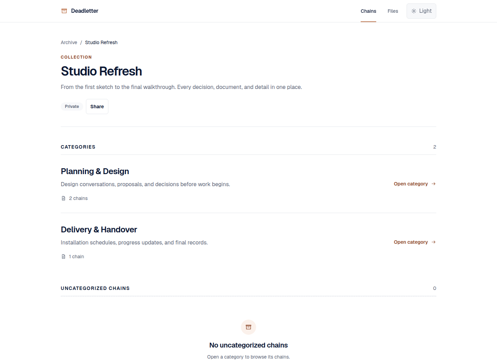
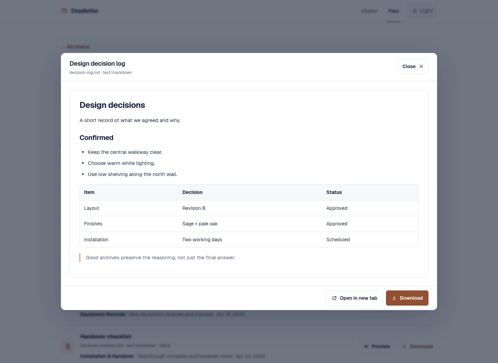

# Architecture

Deadletter is a small Node.js/Next.js reader for filesystem-backed email and
document archives. It is intentionally not a mail server, CMS, database-backed
records system, or general-purpose file manager.

## Application shape

The App Router renders archive pages at request time. Server-only modules under
`lib/server/` resolve the archive root, parse manifests and Markdown
frontmatter, enumerate attachments, and enforce filesystem path safety. Client
components are limited to presentation interactions such as previews, filters,
theme selection, and timeline order.

Filesystem-backed pages and file handlers use the Node.js runtime and dynamic
rendering. A normal archive edit appears after a browser refresh; no rebuild is
normally required. The browser does not watch the filesystem or refresh itself.

## Archive model

The archive root is selected by `ARCHIVE_DATA_DIR`, or defaults to
`data/chains/`. Every chain is a direct child of that root. `chain.yml` names
the chain and its stable `resourceId`; `emails/` holds Markdown entries; and
attachments remain normal files below the owning chain directory.

An optional root `archive.yml` creates a virtual collection/category hierarchy.
It groups flat chains without moving them or changing their canonical chain
routes. Collections and chains have immutable stable resource IDs for share
grant authorization. Categories are organizational only and do not have IDs.

The complete input contract, including validation outcomes and migration
compatibility, is [Archive Content Format Specification](archive-content-format.md).

In the UI, categories organize chains without changing their filesystem paths:

## Ingestion boundary

Deadletter reads canonical archive files but does not extract PDFs, connect to
mailboxes, run OCR as a service, or expose an upload/editing interface. Content
preparation happens outside the running application. The supported project
workflow uses a local coding agent with the bundled `import-email-export` skill
to inspect user-provided exports and attachments, write the filesystem format,
and validate it before the application reads it.

This keeps uncertain extraction and deduplication decisions visible to the
user, keeps original source material read-only, and avoids giving the web
process write access to private archive content. The workflow is documented in
[Agent-assisted imports](agent-assisted-imports.md); the format specification,
schemas, and parsers remain authoritative for accepted content.

## File serving

Archive attachments are never placed in `public/`. The application validates
chain slugs and every requested path segment, proves normalized and real-path
containment, rejects symlink escapes and directories, determines MIME from the
resolved filename, and streams regular files without buffering them wholesale.

The private file route is available only after private authorization. Shared
files use dedicated grant-scoped routes and must both pass the same filesystem
checks and correspond to a referenced attachment in a currently authorized
chain. The [authentication documentation](authentication-and-sharing.md)
describes that additional scope boundary.

## Presentation model

The homepage lists valid chains and virtual collections. Collection and category
pages lead to chains; a chain page renders validated entries as a chronological
continuous-scroll timeline. The file browser aggregates referenced attachments
across the private archive. PDF, common images, plain text, and Markdown have
practical browser-native previews; risky or unsupported formats use a safe
download/open fallback.

Markdown attachments reuse the same readable formatting as email bodies:

<picture>
  <source media="(prefers-color-scheme: dark)" srcset="screenshots/19-markdown-preview-dark.png">
  
</picture>

## Boundaries

- Archive loaders and filesystem utilities do not make authorization decisions.
- Private and shared request boundaries authorize access before invoking generic
  loaders.
- Private archive identity comes from Cloudflare Access; application code
  verifies the Access JWT rather than trusting edge enforcement alone.
- Share grants are durable SQLite state, while archive records remain files.

For operational topology and security controls, see
[Deployment](deployment.md) and [Authentication and sharing](authentication-and-sharing.md).
